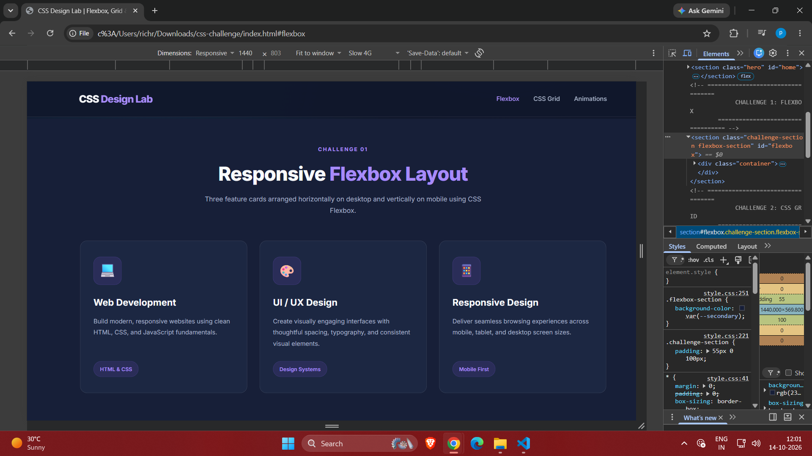
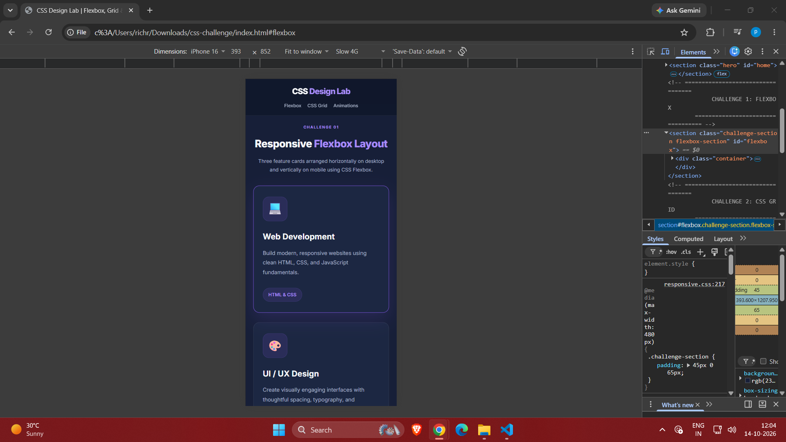
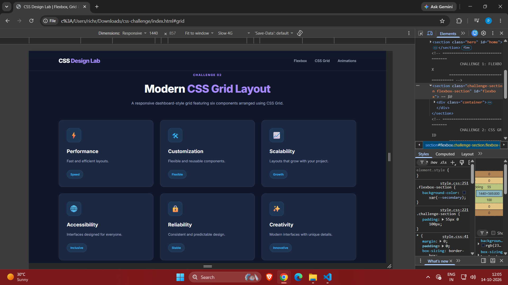
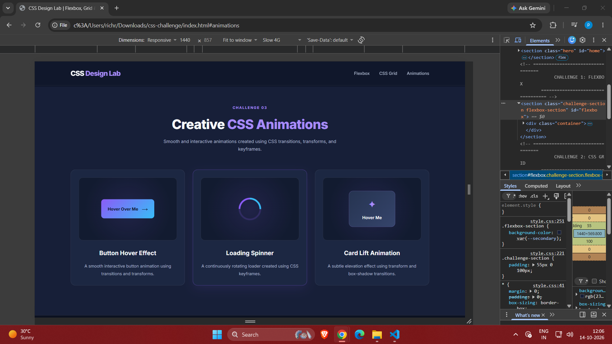

# CSS Design Lab

A responsive CSS challenge project created as part of the **WeIntern Web Development Internship – Week 1, Task 3**.

This project demonstrates modern CSS layout techniques using Flexbox, CSS Grid, and CSS animations.

## Live Demo

🌐 **Live Website:** [CSS Design Lab](https://preetamsalunke.github.io/css-design-lab/)

💻 **GitHub Repository:** [View Source Code](https://github.com/PreetamSalunke/css-design-lab)

## Features

### 1. Responsive Flexbox Layout
- Three feature cards arranged horizontally on desktop
- Vertically stacked cards on mobile screens
- Flexible widths, alignment, and spacing
- Interactive card hover effects

### 2. CSS Grid Layout
- Six cards arranged in a responsive grid
- Three columns on desktop
- Two columns on tablets
- One column on mobile devices
- Built using CSS Grid and `repeat()`

### 3. CSS Animations
- Interactive button hover animation
- Animated loading spinner using keyframes
- Card lift effect using transitions and transforms

### 4. Responsive Design
- Mobile-friendly navigation
- Responsive typography and spacing
- Layout adjustments for desktop, tablet, and mobile

## Technologies Used

- HTML5
- CSS3
- CSS Flexbox
- CSS Grid
- CSS Transitions
- CSS Transforms
- CSS Keyframes
- CSS Media Queries

## Project Structure

```text
css-challenge/
├── index.html
├── css/
│   ├── style.css
│   ├── flexbox.css
│   ├── grid.css
│   ├── animations.css
│   └── responsive.css
├── screenshots/
│   ├── flex-desktop.png
│   ├── flex-mobile.png
│   ├── grid-layout.png
│   └── animation-demo.png
└── README.md
```

## Screenshots

### Flexbox Desktop


### Flexbox Mobile


### CSS Grid Layout


### CSS Animations


## How to Run

1. Download or clone this repository.
2. Open the project folder.
3. Open `index.html` in a web browser.

No additional dependencies or installation required.

## Internship Details

- **Internship:** Web Development
- **Organization:** WeIntern Pvt Ltd
- **Week:** 1
- **Task:** 3 – CSS Challenge

## Author

**Preetam Salunke**

Developed as part of the WeIntern Web Development Internship.
